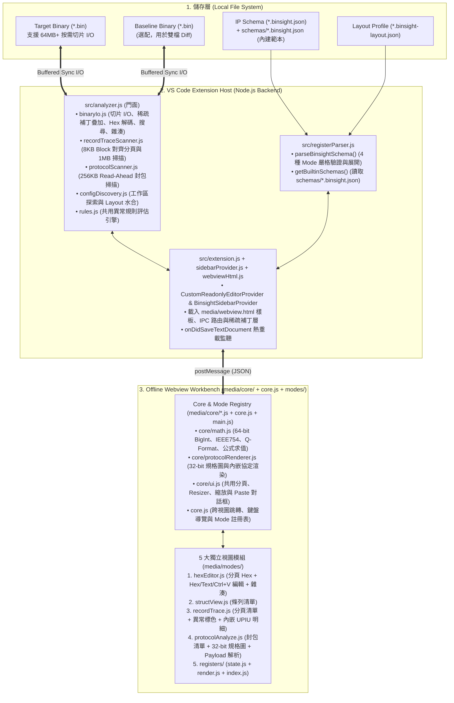

# Binsight 系統架構與詳細設計書 (System Architecture & Detailed Design)

> **版本**：v0.1.0  
> **關聯文件**：[SPECIFICATION.md](file:///home/cy023/project/binsight/SPECIFICATION.md) | [README.md](file:///home/cy023/project/binsight/README.md)

---

## 1. 系統分層架構 (Layered Architecture)

Binsight 採用 **Extension Host (Node.js 後端)** 與 **Webview (瀏覽器沙盒前端)** 雙層分離架構，全程 **零外部執行期依賴 (Zero Runtime Dependencies)**，確保可在完全離線的環境運作。

---

## 2. 效能與記憶體設計重點 (Performance & Memory Safeguards)

1. **零全檔載入 (Zero Full-File Memory Load)**：
   * 開啟 64 MB 甚至更大的 `.bin` 檔時，後端僅使用 `fs.statSync` 取得檔案大小，並依各模式按需切取當前視窗所需的位元組。
   * 檔案雜湊 (`computeFileHashes`) 採用 `fs.createReadStream` 串流計算（常數記憶體），且超過 64 MB 自動略過以避免開啟延遲。
2. **Repeat Struct 的 O(1) 定位與 1 MB 區塊串流掃描 (`queryRepeatEntries`)**：
   * 未套用過濾器時，直接依 `blockIdx = Math.floor(N / entriesPerBlock)` 與 `fileOffset = blockIdx * blockSize + slotIdx * entrySize` 做 O(1) 定位讀取，瞬間完成分頁。
   * 套用 `Type` 或 `Hide Empty` 過濾時，以 **1 MB Block 對齊緩衝區**循序掃描並跳過每塊尾端 Padding，僅將當前頁面的 100 筆 Entry 傳給 Webview。
3. **Protocol Scanner 的 256 KB Read-Ahead Window (`scanProtocolPackets`)**：
   * 掃描多達 50,000 筆 UPIU 封包時，透過單一重複使用的 **256 KB 預讀視窗 (`winBuf`)** 進行記憶體內解析，將原本數萬次的 `fs.readSync` 系統呼叫大幅縮減為數十次，避免 I/O 瓶頸。
4. **側邊欄單次掃描快取 (`BinsightSidebarProvider._scanAllWorkspaceFiles`)**：
   * 每次展開或重新整理側邊欄時，僅對工作區執行一次目錄遍歷（深度上限 3 層），同時分類收集 `.bin`、`*.binsight.json` 與 `*.binsight-layout.json` 並快取結果。
5. **零複製記憶體稀疏補丁層 (`buildPatchOverlay` / `applyOverlayToBuffer`)**：
   * 在 Hex Editor 進行編輯或 `Ctrl+V` 貼上時，後端僅於記憶體維護稀疏補丁映射表 (`Map<offset, byte>`)，切換至其他 4 個模式或進行 Baseline Diff 時直接疊加於讀取緩衝區上，完全避免複製 64 MB+ 暫存檔，直到使用者點擊 `Save As...` 才寫出新檔。

---

## 3. 檔案結構一覽

| 檔案路徑 | 核心職責 |
| :--- | :--- |
| [package.json](file:///home/cy023/project/binsight/package.json) | 註冊指令、Custom Editor、Activity Bar 側邊欄視圖與 JSON Schema 驗證 |
| [src/extension.js](file:///home/cy023/project/binsight/src/extension.js) | Extension 入口、命令註冊與 Webview IPC 訊息協調 |
| [src/sidebarProvider.js](file:///home/cy023/project/binsight/src/sidebarProvider.js) | Activity Bar 側邊欄 TreeView (`BinsightSidebarProvider`) 與單次掃描快取 |
| [src/webviewHtml.js](file:///home/cy023/project/binsight/src/webviewHtml.js) | 載入 `webview.html` 樣板、CSP Nonce 與前端腳本組裝 |
| [src/analyzer.js](file:///home/cy023/project/binsight/src/analyzer.js) | 分析協調門面 (`analyzeFile`) 與後端模組統一匯出 |
| [src/binaryIo.js](file:///home/cy023/project/binsight/src/binaryIo.js) | 切片讀取、記憶體稀疏補丁疊加 (`buildPatchOverlay`)、Text Hex 解碼、搜尋、Baseline Diff 掃描與串流雜湊 |
| [src/recordTraceScanner.js](file:///home/cy023/project/binsight/src/recordTraceScanner.js) | Record Trace O(1) 分頁與 1 MB Block 對齊串流掃描 |
| [src/protocolScanner.js](file:///home/cy023/project/binsight/src/protocolScanner.js) | Protocol Analyze 256 KB Read-Ahead 封包掃描（擷取最多 256 B Payload） |
| [src/configDiscovery.js](file:///home/cy023/project/binsight/src/configDiscovery.js) | 工作區 Schema/Layout 探索、自動匹配與 Layout 水合 |
| [src/rules.js](file:///home/cy023/project/binsight/src/rules.js) | 共用異常規則檢查引擎 (`evaluateEntryRules`)，支援欄位與 bitfield 條件標色 |
| [src/registerParser.js](file:///home/cy023/project/binsight/src/registerParser.js) | 4 種模式的 `*.binsight.json` 嚴格驗證、`*.binsight-layout.json` 解析與展開 |
| [schemas/](file:///home/cy023/project/binsight/schemas) | JSON Schema 驗證定義與 8 份內建 `*.binsight.json` 範本 |
| [media/webview.html](file:///home/cy023/project/binsight/media/webview.html) | Webview 靜態 HTML 樣板 |
| [media/core.js](file:///home/cy023/project/binsight/media/core.js) | 跨視圖跳轉、鍵盤導覽、UI 狀態持久化與 Mode 註冊表組裝 |
| [media/core/](file:///home/cy023/project/binsight/media/core) | `math.js`（BigInt/Float/公式求值）、`protocolRenderer.js`（32-bit 規格圖渲染）與 `ui.js`（分頁/縮放/Modal/Resizer） |
| [media/modes/](file:///home/cy023/project/binsight/media/modes) | `hexEditor.js`、`structView.js`、`recordTrace.js`、`protocolAnalyze.js` 與 `registers/` (`state.js`, `render.js`, `index.js`) |
| [media/main.js](file:///home/cy023/project/binsight/media/main.js) | Webview 啟動協調器與 `postMessage` 分派入口 |
| [media/main.css](file:///home/cy023/project/binsight/media/main.css) | 基於 VS Code 原生主題變數的簡潔樣式、Sticky HUD、32-bit Protocol 圖示與異常嚴重度標色 |
| [scripts/package-vsix.py](file:///home/cy023/project/binsight/scripts/package-vsix.py) | 離線產生 `[0x]` `resources/icon.png` 並封裝為 `binsight-0.1.0.vsix` |
| [scripts/install-vsix.py](file:///home/cy023/project/binsight/scripts/install-vsix.py) | 跨平台（Windows / Linux / macOS）離線打包並呼叫 VS Code CLI 安裝 `.vsix` |
| [scripts/test-analyzer.js](file:///home/cy023/project/binsight/scripts/test-analyzer.js) | 產生測試 `.bin` 樣本並執行全模式、Intel HEX Baseline Diff、UFS UPIU/SCSI 與嚴格 Schema 驗證測試 |
