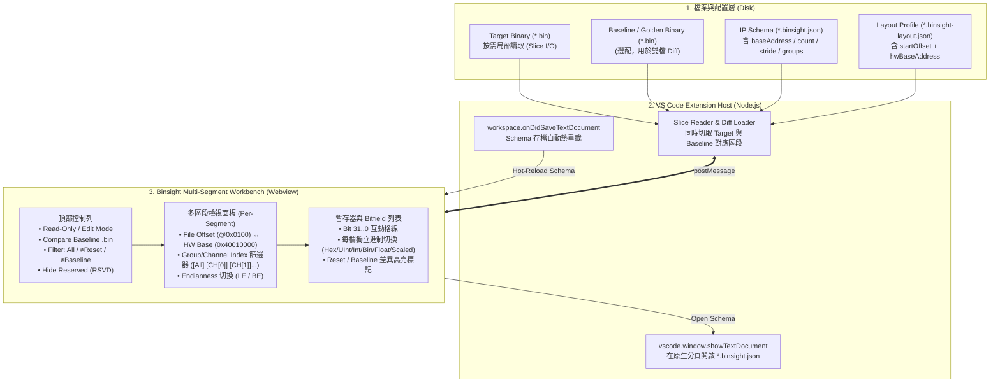

# Binsight v0.2 Architecture & Design Specification

本規格書整合了 `/grill-me` 訪談收斂出的 **6 項核心設計決策**，並提供 **4 種不同真實工程情境下的 `.bin` 範例解析對照**。

---

## 1. 核心設計決策總覽 (Resolved Design Decisions)

| 設計維度 | 收斂決策內容 |
| :--- | :--- |
| **1. 位址映射模型 (Address Mapping)** | **雙軌位址顯示**：每個 Segment 以 `startOffset` (檔案實際讀取 Byte 位置) 讀取資料，並支援設定 `hwBaseAddress`（預設帶入 `*.binsight.json` 的 `baseAddress`，可於區段個別覆寫並存入 Layout）。每個暫存器同時顯示： • **HW Address** (`0x40010004`) • **File Offset** (`@0x0104`) • **Relative Offset** (`+0x04`) |
| **2. 陣列與重複結構 (Arrays & Strides)** | **支援單一 Register 陣列與 Struct Group 重複 (`count` + `stride`)**： • 單一暫存器可設定 `"count": 2, "stride": 4`（展開為 `DMA_IRQ_BANK[0..1]`）。 • 支援 `"groups"`（Struct Array，例如 4 個 DMA Channel，每個含 `CFG`、`SRC_ADDR`、`DST_ADDR`、`STATUS` 四個暫存器，`stride: 16`），並在 UI 提供 **Channel / Array Filter**（可選看 `All`、`Global Regs` 或單看 `CH[2]`）。 |
| **3. 異常與差異比對 (Reset & Binary Diff)** | **雙重比對與一鍵過濾**： • **偏離 Reset 高亮**：當暫存器定有 `resetValue` 且當前值不等於預設值時標示 `≠ Reset`。 • **雙 `.bin` 檔案 Diff (`Compare Baseline .bin`)**：可載入一份 Golden/Baseline `.bin` 檔，後端按相同 Segment 切片讀取比對，高亮顯示 `Baseline 0x... → Current 0x...`。 • 提供篩選器：`All Registers` / `≠ Reset Value Only` / `≠ Baseline .bin Only`。 |
| **4. 欄位呈現與精簡度 (Field UX)** | **每欄獨立格式切換 + 隱藏 Reserved 欄位**： • 每個 Bitfield 列內建輕量格式切換選單（`Auto` / `Hex` / `UInt` / `Int` / `Bin` / `Float` / `Scaled` / `All`），可針對個別欄位切換進制。 • 工具列提供 **`Hide Reserved (RSVD)`** 勾選框，一鍵隱藏名稱為 `RSVD` / `RESERVED` 或標記 `"reserved": true` 的保留位元欄位。 |
| **5. 匯出範圍 (Export Scope)** | **保持精簡**：僅保留 **純文字報告匯出 (`.txt`，含 HW Address 與 Diff 狀態)** 與開啟編輯模式後的 **另存新二進位檔 (`Save As New .bin`)**。 |
| **6. Schema 編輯與熱重載 (Hot-Reload)** | **原生編輯器整合 + 自動熱重載 (`onDidSaveTextDocument`)**： • 移除 Webview 內嵌的 JSON 文字框，保持面板乾淨。 • 每個區段提供 **`Open Schema`** 按鈕，點擊直接在 VS Code 原生分頁開啟該 `*.binsight.json`（享完整 JSON Schema 自動補全與檢查），存檔時面板自動即時重載並刷新解碼結果！ |

---

## 2. 系統資料流與架構圖 (v0.2 Architecture)

---

## 3. 四大實際工程情境 `.bin` 範例解析 (Included in `samples/`)

專案內已透過 [test-analyzer.js](file:///home/cy023/project/binsight/scripts/test-analyzer.js) 自動生成以下 **4 種不同應用情境的 `.bin` 樣本與對應 Schema**，可直接於 VS Code 內開啟驗證：

---

### 情境一：大型稀疏 SoC Crash Dump 多區段檢視與 Golden Diff 比對
* **測試檔案**：
  * 待測異常檔：[scenario1_soc_crash.bin](file:///home/cy023/project/binsight/samples/scenario1_soc_crash.bin) (`4096 Bytes` 稀疏二進位檔)
  * 正常基準檔：[scenario1_soc_golden.bin](file:///home/cy023/project/binsight/samples/scenario1_soc_golden.bin)
  * 多區段配置檔：[scenario1_soc.binsight-layout.json](file:///home/cy023/project/binsight/samples/scenario1_soc.binsight-layout.json)
* **情境說明**：
  一份從 SoC 傾印出來的二進位檔，裡面包含 **4 個分佈在不連續位置的 IP 區塊**（其中兩個為相同 PCIe PHY IP 的不同通道，套用同一份 [pcie_phy.binsight.json](file:///home/cy023/project/binsight/samples/pcie_phy.binsight.json)）：

| 區段名稱 (Label) | 檔案位移 (File Offset) | 硬體基底位址 (HW Base) | 套用 Schema | 關鍵解碼與 Diff 異常發現 (`crash.bin` vs `golden.bin`) |
| :--- | :--- | :--- | :--- | :--- |
| `#1 SYS_CTRL_MAIN` | `0x0000` (`8 B`) | `0x40000000` | [sys_ctrl.binsight.json](file:///home/cy023/project/binsight/samples/sys_ctrl.binsight.json) | • `HW 0x40000000` (`SYS_CTRL`)：`0x00180533 → 0x80180537` &nbsp;&nbsp;- `SOFT_RST [31]` = `1 (ASSERT_RESET)` &nbsp;&nbsp;- `OP_MODE [3:1]` = `3 (DIAGNOSTIC)` • `HW 0x40000004` (`SYS_STATUS`)：`0x0410FC43 → 0x084CFCFB` &nbsp;&nbsp;- `PLL_LOCK [1]` = `0 (UNLOCKED)` &nbsp;&nbsp;- `DIE_TEMP [31:16]` = `2124` $\rightarrow$ **`92.75 °C`** (正常為 `25.0 °C`) |
| `#2 PCIE_PHY_LANE0` | `0x0100` (`8 B`) | `0x40010000` | [pcie_phy.binsight.json](file:///home/cy023/project/binsight/samples/pcie_phy.binsight.json) | • 狀態完全正常 (`= Reset`、`= Baseline`)：`GEN4_16G`、`TX_SWING = 800 mVpp`、`CDR_GAIN = 2.5 (UQ4.4)`、`DFE_TAP1 = -6 tap`。 |
| `#3 PCIE_PHY_LANE1` | `0x0140` (`8 B`) | `0x40011000` | [pcie_phy.binsight.json](file:///home/cy023/project/binsight/samples/pcie_phy.binsight.json) | • `HW 0x40011004` (`PHY_ERR_CNT`)：`0x00000000 → 0x0005001F` &nbsp;&nbsp;- `SYM_ERR_CNT [31:16]` = `5` &nbsp;&nbsp;- `DISP_ERR_CNT [15:0]` = `31` |
| `#4 DMA_ENGINE_0` | `0x0200` (`80 B`) | `0x40020000` | [dma_engine.binsight.json](file:///home/cy023/project/binsight/samples/dma_engine.binsight.json) | • `HW 0x4002003C` (`CH[2].STATUS`)：`STATE [2:0]` = `7 (ABORT_ERR)`，且 `REMAIN_BYTES` 殘留 `256 B` 未傳完。 |

* **操作驗證方式**：
  1. 右鍵開啟 `scenario1_soc_crash.bin` $\rightarrow$ 右上角 **Layout Profile** 選擇 `Scenario 1: SoC Multi-IP Crash Dump Layout`。
  2. 點擊左上角 **`Compare Baseline .bin...`** 選擇 `scenario1_soc_golden.bin`。
  3. 將 **Filter** 切換為 **`≠ Baseline .bin Only`**，畫面會瞬間過濾掉所有正常的暫存器（如整個 `PCIE_PHY_LANE0` 與 `DMA CH[0], CH[1], CH[3]`），只留下發生異常的 4 個暫存器！

---

### 情境二：多通道重複結構與陣列展開 (Multi-Channel Struct Groups & Register Arrays)
* **測試檔案**：[scenario2_dma_channels.bin](file:///home/cy023/project/binsight/samples/scenario2_dma_channels.bin) (`80 Bytes`) + [dma_engine.binsight.json](file:///home/cy023/project/binsight/samples/dma_engine.binsight.json)
* **情境說明**：
  展示 `*.binsight.json` 如何精簡描述「單一暫存器陣列 (`count` + `stride`)」與「多暫存器結構群組 (`groups`)」，避免手寫展開數十個重複暫存器：
  * **單一 Register Array**：`DMA_IRQ_BANK` (`offset: "0x04", count: 2, stride: 4`) $\rightarrow$ 自動展開為 `DMA_IRQ_BANK[0]` (`+0x04`) 與 `DMA_IRQ_BANK[1]` (`+0x08`)。
  * **Struct Group Array**：`CH` (`offset: "0x10", count: 4, stride: 16`) $\rightarrow$ 每個通道包含 `CFG` (`+0x00`)、`SRC_ADDR` (`+0x04`)、`DST_ADDR` (`+0x08`)、`STATUS` (`+0x0C`)，自動展開為 `CH[0].*` ~ `CH[3].*` 共 16 個暫存器。
* **操作驗證方式**：
  * 在區段內上方的 **Channel / Array Filter** 點擊 **`CH[2]`**，即可單獨檢視第 2 通道的 4 個 Descriptor 暫存器；勾選上方 **`Hide Reserved (RSVD)`** 即可隱藏所有保留位元欄。

---

### 情境三：Big-Endian 網路/感測器封包與混合數值型別 (ASCII / Signed Int / Q-Format / IEEE-754 Float32)
* **測試檔案**：[scenario3_sensor_packet_be.bin](file:///home/cy023/project/binsight/samples/scenario3_sensor_packet_be.bin) (`16 Bytes`) + [sensor_telemetry.binsight.json](file:///home/cy023/project/binsight/samples/sensor_telemetry.binsight.json)
* **情境說明**：
  在通訊協定或感測器 Telemetry Binary 中，資料常以 **Big-Endian (`BE`)** 封裝，且單一 Struct 內混用多種特殊數值編碼：

| 相對位移 | 欄位名稱 | 位元範圍 | Schema 型別設定 | 原始 Hex (BE) | Binsight 自動解碼結果 |
| :--- | :--- | :--- | :--- | :--- | :--- |
| `+0x00` | `MAGIC_TAG` | `[31:0]` | `"type": "ascii"` | `0x53454E53` | **`"SENS"`** (ASCII 字串標籤) |
| `+0x04` | `GYRO_OFFSET_X` | `[31:16]` | `"type": "int", "scale": 0.05, "unit": "dps"` | `0xFF88` | Signed Int = **`-120`** $\rightarrow$ 物理量 **`-6 dps`** |
| `+0x04` | `GYRO_OFFSET_Y` | `[15:0]` | `"type": "int", "scale": 0.05, "unit": "dps"` | `0x0055` | Signed Int = **`+85`** $\rightarrow$ 物理量 **`4.25 dps`** |
| `+0x08` | `ACCEL_SCALE_GAIN` | `[31:16]` | `"type": "fixed", "qFormat": "UQ4.12"` | `0x1400` | 定點數 `5120 / 4096` = **`1.25 (UQ4.12)`** |
| `+0x08` | `BOARD_TEMP` | `[15:0]` | `"type": "scaled", "scale": 0.0625, "valueOffset": -40` | `0x0448` (`1096`) | 線性換算 = **`28.5 °C`** |
| `+0x0C` | `VDD_VOLTS` | `[31:0]` | `"type": "float", "unit": "V"` | `0x40533333` | IEEE-754 Float32 = **`3.3 V`** |

---

### 情境四：8-bit (1-Byte) I2C PMIC 電源管理晶片暫存器表
* **測試檔案**：[scenario4_pmic_8bit.bin](file:///home/cy023/project/binsight/samples/scenario4_pmic_8bit.bin) (`10 Bytes`) + [pmic_bucks.binsight.json](file:///home/cy023/project/binsight/samples/pmic_bucks.binsight.json)
* **情境說明**：
  針對 I2C / SPI 介面常見的 **8-bit (`size: 1`) 暫存器**與多路電源軌 (`BUCK[0..3]`，`stride: 2`)：
  * `+0x00 PMIC_CHIP_ID` (`0xA2`)：8-bit 格線顯示 `Bit 7..0`，拆解 `VENDOR_ID [7:4] = 0xA`、`REV_ID [3:0] = 0x2`。
  * `+0x01 PMIC_IRQ_FLAGS` (`0x02`)：`OVP_FAULT [1:1] = 1 (OVER_VOLTAGE)`。
  * `+0x02..+0x09 BUCK[0..3]`：4 路降壓轉換器，直接換算各路 DAC 設定電壓：
    * `BUCK[0].VOUT_DAC` (`0xC6`)：`PGOOD = 1 (POWER_GOOD)`、`VSET = 70` $\rightarrow$ **`1200 mV`**
    * `BUCK[1].VOUT_DAC` (`0xA3`)：`PGOOD = 1 (POWER_GOOD)`、`VSET = 35` $\rightarrow$ **`850 mV`**
    * `BUCK[2].VOUT_DAC` (`0xFA`)：`PGOOD = 1 (POWER_GOOD)`、`VSET = 122` $\rightarrow$ **`1720 mV`**
    * `BUCK[3].VOUT_DAC` (`0x1E`)：`PGOOD = 0 (REGULATING)`、`VSET = 30` $\rightarrow$ **`800 mV`** (且 `BUCK[3].CTRL.RAIL_EN = 0 OFF`)
